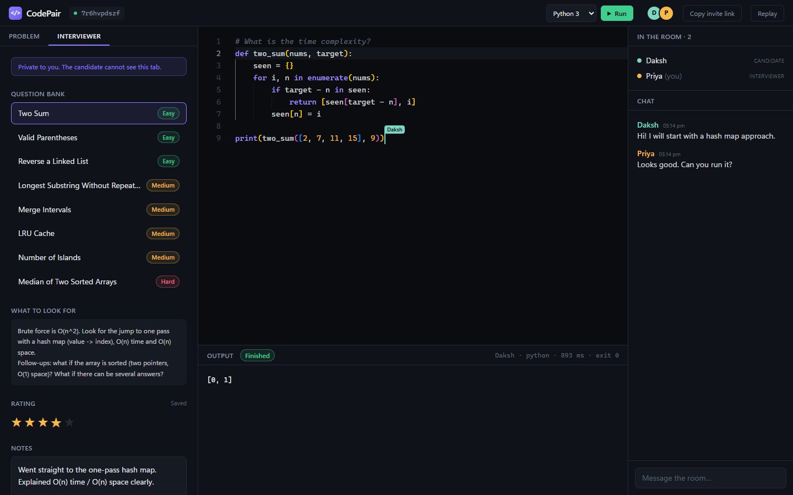
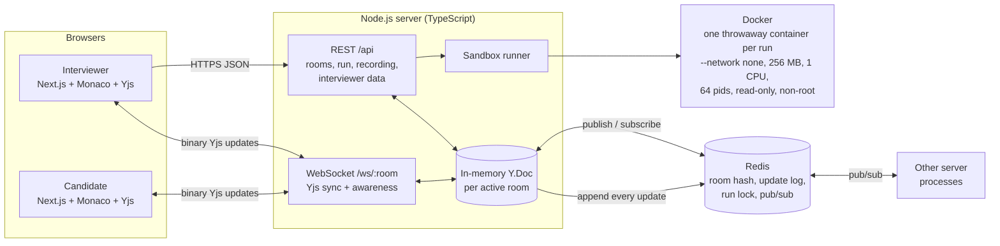
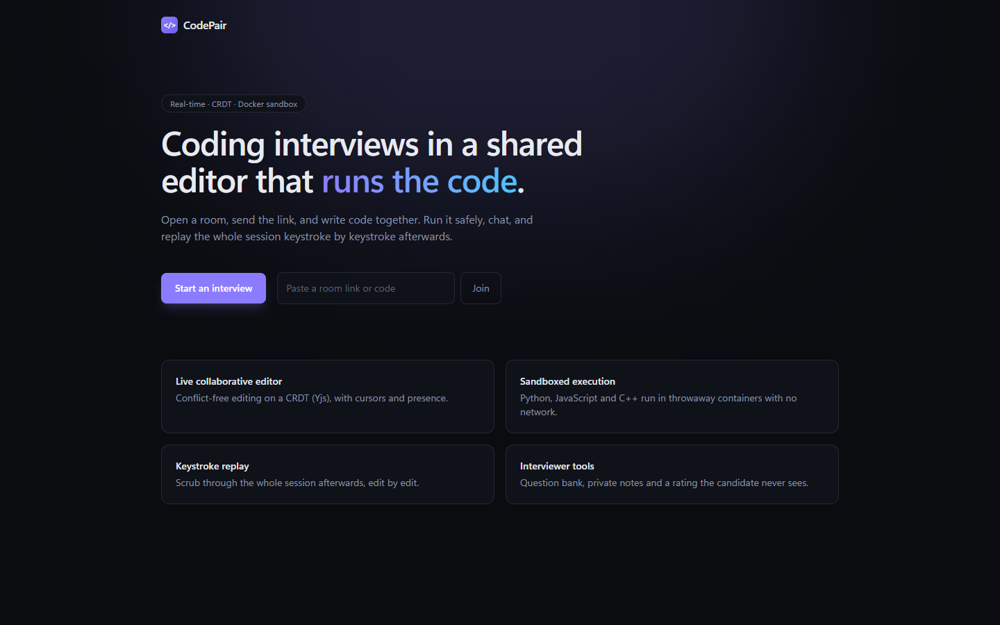
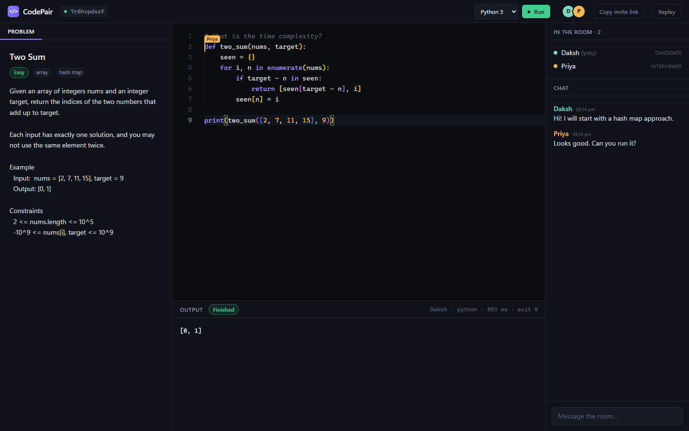
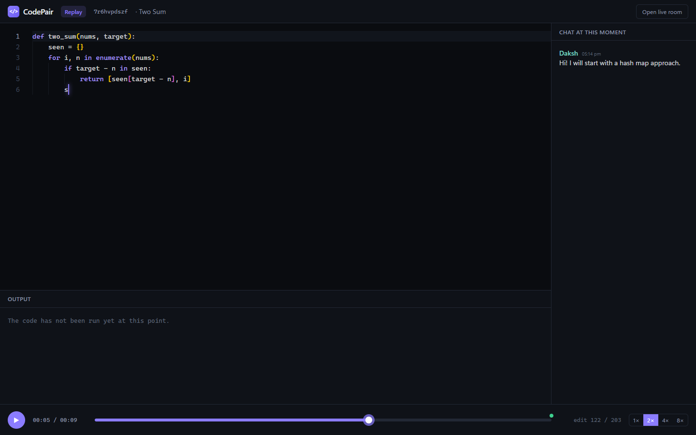

# CodePair

A real-time collaborative coding interview platform. An interviewer opens a room and shares the link. Both people edit the same code live, with each other's cursors, and run it in a locked-down Docker container. Afterwards, the whole session can be replayed keystroke by keystroke.



## Features

- **Collaborative editor.** Monaco (the editor inside VS Code) synced through a CRDT ([Yjs](https://yjs.dev)) over WebSocket, with live cursors, names and presence.
- **Sandboxed execution.** Python 3, JavaScript (Node) and C++17 run in a throwaway container with no network, a 256 MB memory cap, 1 CPU, a 10 s time limit, a 64-process limit, a read-only filesystem and a non-root user.
- **Shared output.** Whoever presses Run, everyone sees "Running…" and then the same output.
- **Session replay.** Every edit is stored with a timestamp. The replay page has play/pause, 1–8× speed, a scrubber, and markers where the code was run. Code, output and chat all replay together.
- **Interviewer panel.** A question bank with private "what to look for" hints, private notes and a 1–5 rating. The candidate's browser never receives any of it.
- **Room chat**, persisted and replayed with the rest of the session.
- **Horizontal scaling.** Several server processes can serve the same room, kept in step by Redis pub/sub (covered by a test).

## Quick start (Windows)

Prerequisites: Docker Desktop (running) and Node.js 20 or newer.

```powershell
.\start.ps1
```

Then open http://localhost:3100. The script starts Redis, builds the sandbox image and installs packages on the first run, then starts both apps.

| Part | Address |
|---|---|
| Web app (Next.js) | http://localhost:3100 |
| Server (REST + WebSocket) | http://localhost:4100 |
| Redis (Docker) | 127.0.0.1:6380 |

Other commands, run from the repo root:

```powershell
npm test                       # 27 tests: CRDT convergence, sandbox limits, end-to-end sync
npm run typecheck              # server + web
npm run bench                  # re-measure the numbers below -> docs/benchmarks.json
node scripts/screenshots.mjs   # two-browser end-to-end demo; refreshes docs/screenshots
```

## Architecture



### How a keystroke travels

1. Monaco reports the change. The binding in [web/lib/yMonaco.ts](web/lib/yMonaco.ts) turns it into an insert or delete on a shared `Y.Text`.
2. Yjs encodes the change as a small binary update (about 20 bytes) and the WebSocket provider sends it to the server.
3. [server/src/sync.ts](server/src/sync.ts) applies it to the room's in-memory document, then:
   - forwards it to every other socket in the room,
   - appends `timestamp|update` to the Redis list `cp:room:<id>:log` (this is both the saved document and the replay recording),
   - publishes it on `cp:pub:<id>` so other server processes can pass it to their own clients.
4. Each other browser applies the update to its own copy, and the binding writes the change into its editor.

No step needs a lock or a fixed order. Yjs updates are commutative and idempotent: in any order, applied any number of times, they produce the same document.

### What is stored where

| Data | Where | Who can read it |
|---|---|---|
| Code, language, current question, last run output, chat | Shared Yjs document (`code`, `state`, `chat`), saved as the Redis update log | Everyone with the room link |
| Names, colours, cursor positions | Yjs *awareness* (presence), never saved | Everyone in the room right now |
| Interviewer notes, rating, question hints | Redis hash `cp:room:<id>`, behind the interviewer key | Interviewer only |

Rooms expire after 7 days without edits (Redis TTL).

### Who is the interviewer?

Creating a room returns a random room id (the shareable link) and a separate 128-bit interviewer key. The key reaches the browser in the URL fragment (`/room/abc#key=…`). Fragments are never sent to a server, so the key stays out of logs. The app then moves it into `localStorage` and strips it from the address bar, so copying the URL shares only the room. Interviewer-only API routes check the key with a constant-time comparison.

## Measured numbers

From `npm run bench` ([docs/benchmarks.json](docs/benchmarks.json)), on one laptop (Intel Core Ultra 5 225H, Docker Desktop on WSL2). Server, Redis and clients all ran on localhost, so latency excludes real network delay.

| What | Result |
|---|---|
| Keystroke from client A to client B through the server (1,000 samples) | p50 **0.16 ms**, p95 0.53 ms, p99 1.14 ms |
| 5 clients typing 2,000 concurrent random edits | converged to identical text in **453 ms** |
| Size of one recorded edit | **~20.5 bytes** on average |
| Rebuild a room from its Redis log (~2,000 updates) | **19 ms** |
| Full sandbox run, median of 7 (container start → output → removal) | Python **515 ms**, JavaScript 562 ms, C++ (compile + run) 767 ms |
| Infinite loop with a 2 s limit | killed, returned after 2.45 s |

The test suite also checks that 3 replicas converge across 50 random trials of 300 edits each, with out-of-order and duplicated delivery. It also checks that the sandbox stops infinite loops, memory bombs, fork bombs, output floods, network access and writes outside `/tmp`.

## Screenshots

| | |
|---|---|
|  |  |
| Landing page | Candidate view: the problem statement, the interviewer's live cursor with a name label, shared output and chat |
|  |  |
| Replay at 60% of the session, with the timeline scrubber | Interviewer view: question bank, hints, rating and private notes |

## Project layout

```
server/                 Node.js + TypeScript backend
  src/index.ts          HTTP server: REST routes + WebSocket upgrade
  src/sync.ts           Yjs sync protocol, Redis persistence, pub/sub
  src/sandbox.ts        Docker sandbox runner and its limits
  src/rooms.ts          room ids, interviewer key, notes and rating
  src/questions.ts      the question bank
  src/redis.ts          Redis connections and key names
  src/config.ts         ports and limits
  test/                 crdt, sandbox and sync tests (vitest)
  scripts/bench.ts      benchmark that produces docs/benchmarks.json
web/                    Next.js + TypeScript + Tailwind frontend
  lib/yMonaco.ts        Monaco <-> Yjs binding, remote cursors, undo
  components/Room.tsx   the interview room (IDE layout)
  components/Replay.tsx the replay page and timeline
sandbox/Dockerfile      Alpine image with python3, node and g++
scripts/screenshots.mjs two-browser end-to-end demo + screenshots
docker-compose.yml      Redis
start.ps1               one-command start
docs/STUDY_GUIDE.md     design explanations and interview Q&A
```

## Limitations (and what I would do next)

- **Container isolation shares the host kernel.** The flags block the common attacks, but a kernel exploit could escape. Production systems add gVisor (`--runtime=runsc`) or Firecracker micro-VMs. See the study guide.
- **The update log is never compacted.** A very long session keeps every update. A fix: every N updates, store `Y.encodeStateAsUpdate(doc)` as a snapshot and trim the list (replay would keep a separate copy).
- **No accounts.** Access is "whoever has the link". Real products add sign-in and room membership.
- **Programs cannot read stdin.** The code arrives on stdin; supporting input would need a second channel.
- **Single machine.** Pub/sub makes several server processes work. Running containers on other machines would need a job queue in front of the sandbox.
